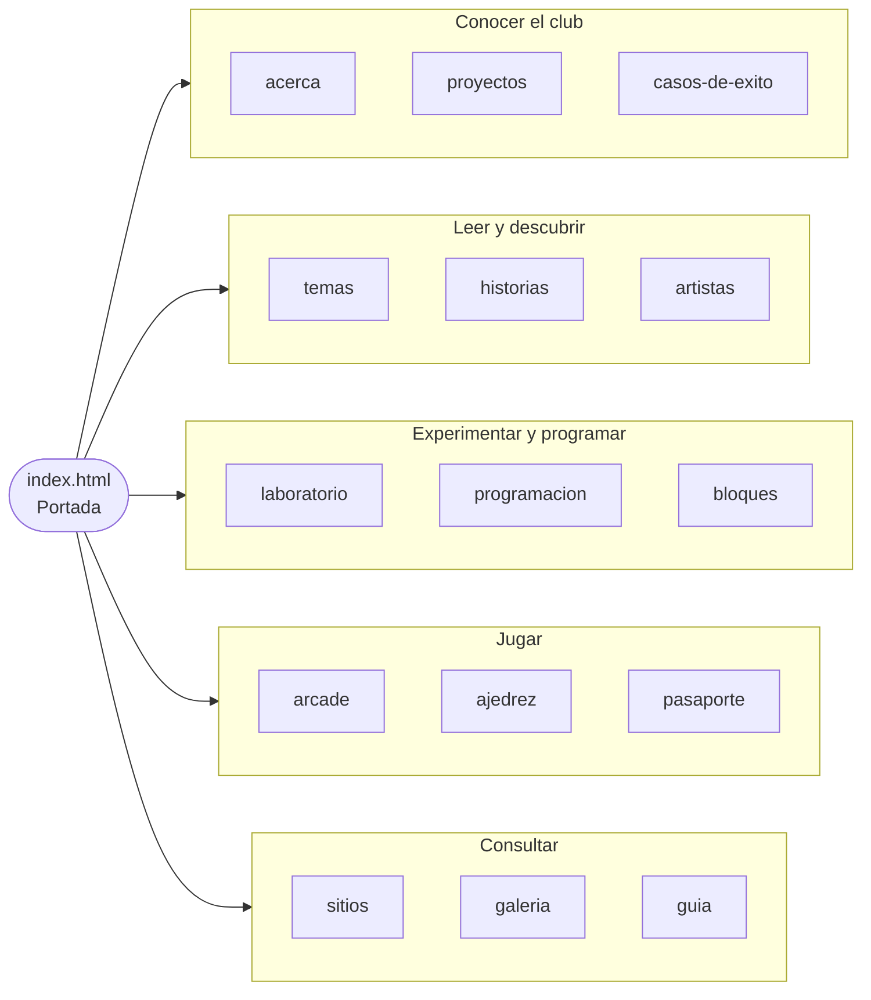
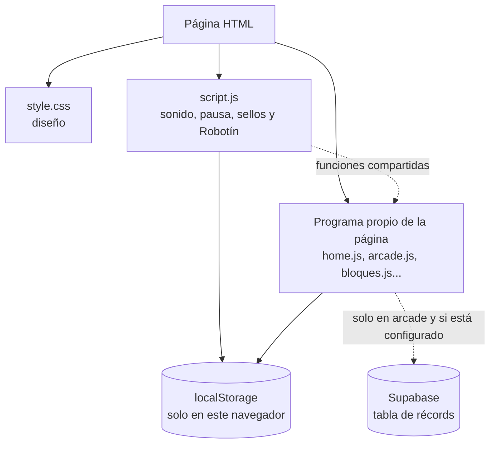
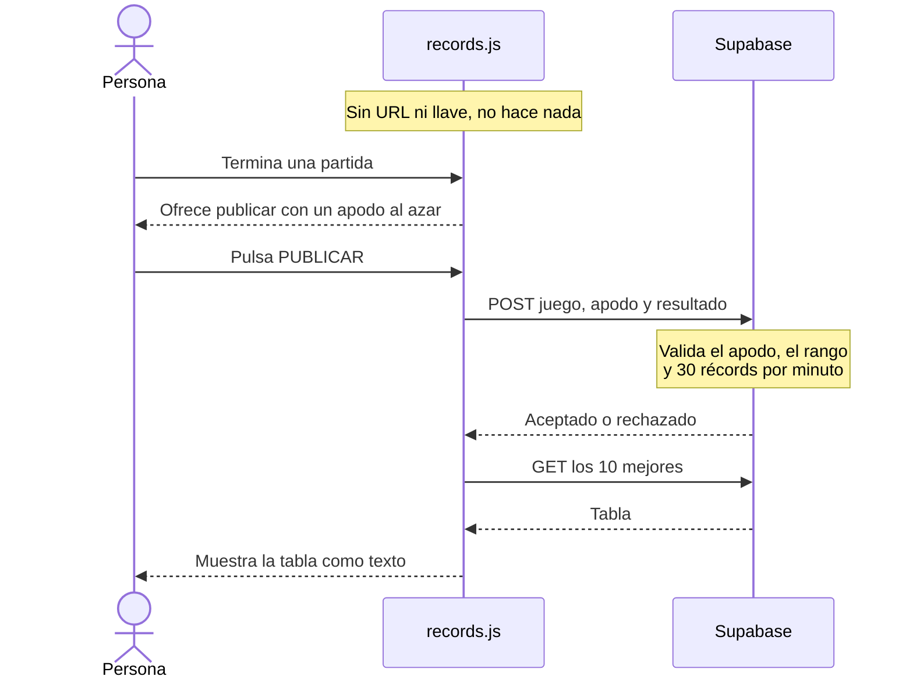
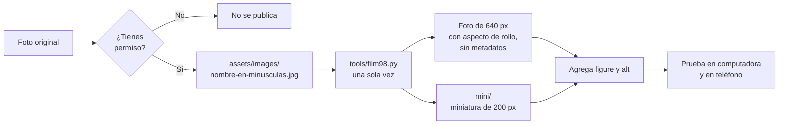

# CiTIAM Labs

[](https://developer.mozilla.org/es/docs/Web/HTML)
[](https://developer.mozilla.org/es/docs/Web/CSS)
[](https://developer.mozilla.org/es/docs/Web/JavaScript)


[](https://github.com/badouintec/CITIAMLABS/commits/main)


**Sitio educativo de Highpoint School — Hermosillo, Sonora**

CiTIAM Labs es el sitio de un club escolar que explora Ciencia, Tecnología, Ingeniería, Artes y Matemáticas. Se ve como una página personal de 1998: fondo de estrellas, colores brillantes, botones en relieve, texto que se desplaza, GIF pixelados, fotos con aspecto de rollo y botones de 88 x 31.

El diseño es retro, pero el sitio usa HTML, CSS y JavaScript actuales. Está pensado para que estudiantes de secundaria puedan recorrerlo, jugar, experimentar, programar, leer cómo se hizo y proponer mejoras.

> **¿Eres estudiante y quieres empezar?** Abre [`guia.html`](./pages/guia.html). Es la versión de este manual pensada para leerse en el navegador. Este README agrega los detalles técnicos y los pasos para publicar.

## Contenido

- [Antes de empezar](#antes-de-empezar)
- [Mapa del sitio](#mapa-del-sitio)
- [Cómo están organizados los archivos](#cómo-están-organizados-los-archivos)
- [Las tres partes de una página web](#las-tres-partes-de-una-página-web)
- [Cómo funcionan los programas](#cómo-funcionan-los-programas)
- [Reglas del diseño de 1998](#reglas-del-diseño-de-1998)
- [Cambiar o agregar fotos](#cambiar-o-agregar-fotos)
- [Cambiar o agregar GIF](#cambiar-o-agregar-gif)
- [Cambiar o agregar contenido](#cambiar-o-agregar-contenido)
- [Probar antes de publicar](#probar-antes-de-publicar)
- [Crear un archivo ZIP](#crear-un-archivo-zip)
- [Publicar con GitHub Pages](#publicar-con-github-pages)
- [Si algo no funciona](#si-algo-no-funciona)
- [Seguridad, privacidad y buenas prácticas](#seguridad-privacidad-y-buenas-prácticas)
- [Créditos de las imágenes](#créditos-de-las-imágenes)
- [Glosario breve](#glosario-breve)

## Antes de empezar

- Para visitar el sitio, abre `index.html` con un navegador moderno.
- No necesitas instalar programas ni tener internet para ver las páginas, las fotos o los juegos. Los enlaces a algunas fuentes de consulta y la tabla de récords sí necesitan conexión.
- Mantén juntos `index.html` y las carpetas `pages` y `assets`. Las páginas buscan en `assets` sus estilos, programas, fotografías y animaciones.
- Si estudias el código, cambia una cosa a la vez y vuelve a cargar la página para ver qué ocurrió.
- Antes de un cambio grande, copia la carpeta completa. Así siempre puedes regresar a la versión que funcionaba.

**El sitio no tiene paso de compilación ni dependencias.** No hay `npm`, frameworks ni bibliotecas: lo que está en los archivos es exactamente lo que recibe el navegador. Mantenlo así. `tools/film98.py` no cuenta: prepara fotos en tu computadora y el sitio nunca lo carga.

## Mapa del sitio



Todas menos la portada viven en `pages/`, con la extensión `.html`.

| Página | Para qué sirve | Programas que carga |
| --- | --- | --- |
| [`index.html`](./index.html) | Portada del club, su historia por generaciones, guía para explorar, misión de observación y libro de visitas. | `script.js`, `home.js` |
| [`acerca.html`](./pages/acerca.html) | Qué es el programa, con video y respuestas para familias y profesores. | `script.js` |
| [`proyectos.html`](./pages/proyectos.html) | Fotografías e historias del cultivo de hongo ostra, la robótica y el jardín escolar. | `script.js` |
| [`casos-de-exito.html`](./pages/casos-de-exito.html) | Proyectos de exalumnos del club, como el equipo IRVEN. | `script.js` |
| [`temas.html`](./pages/temas.html) | Explicaciones sencillas de Ciencia, Tecnología, Ingeniería, Artes y Matemáticas. | `script.js` |
| [`historias.html`](./pages/historias.html) | Historias reales de ciencia, con adivinanzas y fuentes. | `script.js`, `historias.js` |
| [`artistas.html`](./pages/artistas.html) | Artistas de Hermosillo y Sonora, y un mural para pintar. | `script.js`, `artistas.js` |
| [`laboratorio.html`](./pages/laboratorio.html) | Siete simuladores: órbitas, epidemia, átomos, tiempo de reacción, sonido, caída libre y reloj de la Tierra. | `script.js`, `laboratorio.js` |
| [`programacion.html`](./pages/programacion.html) | Curso inicial de HTML, CSS y JavaScript con un taller de código interactivo. | `script.js`, `programacion.js` |
| [`bloques.html`](./pages/bloques.html) | Programación con bloques, estilo Scratch: un robot, siete misiones y el JavaScript equivalente. | `script.js`, `bloques.js` |
| [`arcade.html`](./pages/arcade.html) | Sala de maquinitas (Robot Runner, Buscacactus, Hongotchi y Expedición), siete retos y la bitácora. | `script.js`, `records.js`, `arcade.js`, `maquinitas.js` |
| [`ajedrez.html`](./pages/ajedrez.html) | Ajedrez completo contra la computadora o entre dos personas, problemas de mate y la matemática del tablero. | `script.js`, `ajedrez-motor.js`, `ajedrez.js` |
| [`pasaporte.html`](./pages/pasaporte.html) | Sellos, rangos, diploma y sala secreta. | `script.js`, `pasaporte.js` |
| [`sitios.html`](./pages/sitios.html) | Directorio de sitios útiles, con reglas de seguridad. | `script.js` |
| [`galeria.html`](./pages/galeria.html) | Todas las fotos y los GIF del sitio, con autores y licencias. | `script.js` |
| [`guia.html`](./pages/guia.html) | Manual del sitio para estudiantes. | `script.js` |

El menú principal, la barra de controles y el pie de página están **copiados en cada página**. Sin herramientas adicionales no hay una forma sencilla de compartirlos. Si cambias uno, cámbialo en las dieciséis páginas. En `index.html` los enlaces llevan `pages/` delante y en las demás no.

El pie de cada página incluye el *Anillo CiTIAM*: enlaces a la sala anterior y a la siguiente, como los antiguos anillos web. El orden es el de la tabla y la última sala regresa a la primera.

## Cómo están organizados los archivos

```text
CITIAMLABS/
|-- index.html             la portada: el único HTML en la raíz
|-- README.md
|-- .gitignore
|-- tools/
|   `-- film98.py        filtro de rollo para fotos nuevas
|-- pages/
|   |-- acerca.html
|   |-- proyectos.html
|   |-- casos-de-exito.html
|   |-- temas.html
|   |-- historias.html
|   |-- artistas.html
|   |-- pasaporte.html
|   |-- sitios.html
|   |-- laboratorio.html
|   |-- programacion.html
|   |-- bloques.html
|   |-- arcade.html
|   |-- ajedrez.html
|   |-- galeria.html
|   `-- guia.html
`-- assets/
    |-- css/
    |   `-- style.css        diseño de todas las páginas
    |-- gifs/                51 animaciones, botones y adornos
    |   `-- ajedrez/         las 12 piezas del tablero
    |-- images/              32 fotos de hasta 640 pixeles, con filtro de rollo
    |   `-- mini/            sus miniaturas de 200 pixeles
    `-- js/
        |-- script.js        común: sonido y pausar animaciones
        |-- home.js          portada
        |-- arcade.js        retos de aprendizaje
        |-- maquinitas.js    Robot Runner, Buscacactus, Hongotchi y Expedición
        |-- records.js       tabla de récords en Supabase
        |-- programacion.js  taller de código
        |-- bloques.js       taller de bloques
        |-- laboratorio.js   simuladores
        |-- historias.js     adivinanzas y la roca que suena
        |-- artistas.js      mural para pintar
        |-- pasaporte.js     pantalla de sellos y diploma
        |-- ajedrez-motor.js reglas del ajedrez y computadora (sin tocar la página)
        `-- ajedrez.js       tablero y botones de ajedrez
```

En la carpeta principal solo está `index.html`, la portada; GitHub Pages la busca ahí. Las demás páginas viven en `pages`. Las imágenes, el diseño y los programas viven dentro de `assets`, que significa "recursos" en inglés.

| Parte | Trabajo que realiza | Comparación sencilla |
| --- | --- | --- |
| HTML | Ordena el texto, los títulos, las imágenes, los botones y los enlaces. | Es el plano y el contenido de una exposición. |
| CSS | Decide colores, tamaños, bordes y cómo se acomoda la página en distintas pantallas. | Es la decoración y la distribución de la exposición. |
| JavaScript | Reacciona a los clics, crea preguntas y actualiza los juegos. | Es la parte que permite que la exposición tenga actividades. |
| `assets/images` | Guarda las fotografías usadas en el sitio. | Es el archivo fotográfico del club. |
| `assets/gifs` | Guarda dibujos animados pequeños que se repiten. | Es una colección de ilustraciones en movimiento. |
| README | Explica cómo recorrer, estudiar y modificar el proyecto. | Es la guía para usar el laboratorio. |

## Las tres partes de una página web

### 1. HTML: contenido y estructura

HTML usa etiquetas para explicar qué significa cada parte. La mayoría de las etiquetas se abren y se cierran:

```html
<h2>Una pregunta para investigar</h2>
<p>Observamos la sombra de una planta en distintos horarios.</p>
```

`<h2>` indica un título de sección y `</h2>` cierra ese título. `<p>` crea un párrafo. Las etiquetas describen la información; no son las instrucciones de color o tamaño.

Una etiqueta de enlace permite ir a otra página:

```html
<a href="proyectos.html">Conocer los proyectos del club</a>
```

El atributo `href` contiene el destino, y la ruta parte de la carpeta del archivo donde lo escribes:

| Desde | Para ir a `proyectos.html` | Para llegar a `assets` | Para volver a la portada |
| --- | --- | --- | --- |
| `index.html` | `pages/proyectos.html` | `assets/...` | `index.html` |
| Una página de `pages` | `proyectos.html` | `../assets/...` | `../index.html` |

`../` significa "sube una carpeta". Los ejemplos de este manual están escritos para una página dentro de `pages`; en `index.html` quita el `../`.

Las imágenes también necesitan una ruta. `src` indica dónde está el archivo y `alt` explica qué muestra:

```html

```

El texto `alt` es importante para las personas que usan lectores de pantalla y para cuando una imagen no se puede ver. Describe lo que aporta la imagen; no incluyas nombres completos de estudiantes.

Todas las páginas tienen la misma estructura:

```text
.page
|-- .announcement          aviso amarillo
|-- header.masthead        título de la página
|-- nav.site-nav           menú principal
|-- .toolbar               sonido y pausar animaciones
|-- .columns
|   |-- aside.sidebar      índice y adornos
|   `-- main.content       el contenido, en tarjetas .article-card
`-- footer.footer          anillo, botones de 88 x 31 y fecha
```

### 2. CSS: diseño y apariencia

El navegador carga el archivo de diseño desde cada página:

```html
<link rel="stylesheet" href="../assets/css/style.css">
```

Una regla CSS selecciona un elemento y le asigna propiedades:

```css
.article-card {
    background: #050505;
    color: white;
    padding: 14px;
}
```

El punto antes de `article-card` quiere decir que la regla se aplica a los elementos que tienen `class="article-card"`. El archivo empieza con un índice numerado: para ir a una sección, busca `== 5` o el número que necesites.

Para experimentar, cambia un color de `assets/css/style.css`, guarda el archivo y recarga el navegador. Si solo cambias CSS, no tienes que modificar HTML.

### 3. JavaScript: acciones y juegos

Cada página carga el programa común y, si lo necesita, el suyo:

```html
<script src="../assets/js/script.js"></script>
<script src="../assets/js/arcade.js"></script>
```

Un programa busca elementos por su identificador (`id`) y espera a que alguien use un botón, una tarjeta o un control:

```javascript
document.querySelector("#idea-button").addEventListener("click", showIdea);
```

`querySelector` encuentra el elemento con el identificador `idea-button`. `addEventListener` espera el evento `"click"`; cuando alguien pulsa el botón, se ejecuta la función `showIdea`.

No cambies el `id` de un botón sin buscar el mismo nombre en JavaScript. Si el HTML y JavaScript usan nombres distintos, el programa no encontrará el botón.

## Cómo funcionan los programas

Cada archivo comienza con un comentario que explica lo que contiene. Están escritos para leerse.

Así se reparte el trabajo cuando el navegador abre una página:



`script.js` siempre se carga antes que el programa propio, porque este usa sus funciones.

### `script.js`: el programa común

Lo cargan las dieciséis páginas. Hace seis cosas: guardar preferencias, sonido, pausar animaciones, los sellos del Pasaporte, el código secreto y Robotín. Las tres primeras:

1. **Guardar preferencias.** `readStorage` y `writeStorage` envuelven a `localStorage`, que puede estar bloqueado en una ventana privada o por reglas de la escuela. Si falla, el sitio sigue funcionando.
2. **Sonido.** El navegador fabrica cada nota con un oscilador; no hay archivos de audio. **MÚSICA MIDI** toca un beat vaporwave original: como un disco de los 80 tocado lento y editado con tijeras (`VAPOR_MELODY`, `VAPOR_CHORDS` y `VAPOR_ARRANGEMENT`, que decide qué pedazos se repiten). Empieza apagada; si alguien la enciende, se recuerda e intenta sonar en cada página. Si el navegador lo bloquea, el botón dice **MÚSICA: HAZ CLIC** y arranca con el primer clic.
3. **Pausar animaciones.** Un GIF no se puede pausar con CSS, así que el botón lo cambia por un `<canvas>` con un solo cuadro y guarda la imagen para devolverla después. Empieza en pausa si el sistema operativo pide reducir el movimiento.

Como un GIF pausado es un `<canvas>`, las reglas de `style.css` para GIF nombran `img` y también `canvas`.

### `home.js`: la portada

Se carga después de `script.js` porque usa sus funciones. Contiene las ideas de **DAME UNA IDEA**, el contador de visitas y el libro de visitas. El contador y las firmas se guardan solo en ese navegador; por eso nadie más puede ver las firmas.

### `maquinitas.js`: la Sala de maquinitas

Cuatro juegos que se entienden en segundos. **Si un juego necesita una explicación larga, está mal hecho.**

- **Robot Runner:** usa un paso fijo de 60 veces por segundo, para correr igual en cualquier pantalla. Su récord se guarda.
- **Buscacactus:** el primer clic nunca pincha.
- **Hongotchi:** los medidores bajan con el tiempo real, incluso con la página cerrada, hasta 72 horas. La máquina del tiempo adelanta una hora.
- **Expedición al Pinacate:** agrega decisiones en `SCENES`. Si das un consejo de seguridad, que sea real.

### `records.js`: la tabla de récords

Robot Runner, Buscacactus y Memorama pueden publicar resultados en [Supabase](https://supabase.com) con `fetch`, sin librerías. Con `SUPABASE_URL` y `SUPABASE_KEY` vacías, las tablas no aparecen y el sitio no se conecta a nada.



**Para conectarlo:**

1. Crea un proyecto en Supabase.
2. En **SQL Editor**, ejecuta el SQL de abajo.
3. En **Project Settings > API Keys**, copia la URL del proyecto y la llave **publishable** (`sb_publishable_...`) a `assets/js/records.js`. **Nunca copies la llave secreta:** todo lo que está en el JS es público.

```sql
create table public.records (
    id uuid primary key default gen_random_uuid(),
    game text not null,
    nickname text not null check (nickname ~ '^(Robot|Cactus|Coyote|Saguaro|Cometa|Átomo|Hongo|Tortuga|Colibrí|Lince|Planeta|Búho) (Azul|Verde|Naranja|Turquesa|Violeta|Plata|Cobre|Neón) [1-9][0-9]$'),
    score integer not null,
    created_at timestamptz not null default now(),
    check (
        (game = 'runner' and score between 1 and 20000)
        or (game = 'buscacactus' and score between 1 and 999)
        or (game = 'memorama' and score between 6 and 500)
    )
);
create index records_game_score on public.records (game, score);

alter table public.records enable row level security;
create policy "todos leen" on public.records for select to anon using (true);
create policy "todos agregan" on public.records for insert to anon with check (true);

-- Desde el 30 de octubre de 2026 las tablas nuevas no reciben permisos solas.
grant select on public.records to anon;
grant insert (game, nickname, score) on public.records to anon;

-- Freno contra quien intente llenar la tabla con un programa.
create function public.records_limit() returns trigger language plpgsql set search_path = '' as $$
begin
    if (select count(*) from public.records where created_at > now() - interval '1 minute') >= 30 then
        raise exception 'demasiados récords por minuto';
    end if;
    return new;
end $$;
create trigger records_limit before insert on public.records for each row execute function public.records_limit();
```

**Qué protege y qué no.** La base de datos solo acepta leer y agregar, apodos de la lista cerrada, puntajes dentro de un rango y 30 récords por minuto. Sin servidor no se puede comprobar que alguien de verdad jugó: se puede publicar un puntaje falso dentro del rango. Para borrar uno, en **Table Editor** abre `records` y elimina la fila.

Si cambias los juegos o los apodos en `records.js`, cambia también el SQL.

### `arcade.js`: los juegos

Tiene una sección por juego, en el mismo orden que la página. Las puntuaciones viven en variables y se pierden al recargar. Solo el Memorama puede publicar su resultado, y solo si la persona lo pide (ver `records.js`).

| Juego | Cómo funciona | Dónde cambiarlo |
| --- | --- | --- |
| 1. Reto relámpago | Cinco problemas de suma, resta o multiplicación en 45 segundos. | `makeMathQuestion` |
| 2. Ruta del robot | Hasta ocho movimientos para llegar al panel solar sin chocar. | `routeRocks` |
| 3. Misión desierto | Cinco preguntas, cada una con su explicación. | `questions` en la sección 3 |
| 4. Memorama STEAM | Seis parejas de concepto y definición. | `memoryTerms` |
| 5. Laboratorio de sombras | Largo de la sombra = altura / tangente(ángulo). Es un modelo para aprender, no una medición meteorológica. | `updateShadowModel` |
| 6. Detective de código | Identifica qué hacen fragmentos de HTML, CSS y JavaScript. | `questions` en la sección 6 |
| 7. Reto RGB | Acierta si los tres canales quedan a 24 puntos o menos del objetivo. | `rgbTolerance` |

Misión desierto y Detective de código comparten la función `createQuiz`. En cada pregunta, `correct` es la posición de la respuesta correcta en `answers`, y `0` es la primera. El juego mezcla las opciones en cada partida, así que puedes escribir siempre la correcta al principio.

El mapa del robot usa coordenadas `"fila,columna"`, y la fila 0 es la de arriba. Si cambias las rocas, comprueba que todavía exista una ruta de ocho pasos o menos.

### `programacion.js`: el taller

Une los tres cuadros de texto en un documento y lo muestra en un `iframe` con `sandbox="allow-scripts"`. El código corre ahí, sin acceso al resto del sitio, y no se envía a ningún servidor. Si el JavaScript tiene un error, aparece un aviso dentro de la vista previa.

### El Pasaporte y Robotín

Están en `script.js` porque aparecen en todas las páginas:

- **Agregar un sello:** añádelo a `STAMPS` y llama a `earnStamp("su-id")` en el momento en que se logra. Quien lo gane verá el aviso de Robotín.
- **Robotín:** sus frases están en `ROBOTIN_LINES`, por página, y `ROBOTIN_JOKES`. Se puede cerrar y recuerda esa decisión.
- **Sala secreta:** el código Konami da el sello `secreto` y abre la sala en el Pasaporte. La pista está en el código fuente de esa página.
- **Dato del día:** `DAILY_FACTS` en `home.js`. Cambia con la fecha, sin servidor. Solo agrega datos que tengan fuente en el sitio.

### `bloques.js`: el taller de bloques

El programa es una lista de objetos, no texto: `{ type: "repeat", args: ["4"], children: [...] }`. Ejecutarlo es recorrer esa lista con un generador (`function*`), que se pausa con `yield` después de cada pasito para que se vea la animación. **Nunca se usa `eval`.**

- **Agregar un bloque:** añádelo a `BLOCK_TYPES`, dile qué hace en `runBlock` y cómo se escribe en JavaScript en `codeFor`.
- **Agregar una misión:** añádela a `MISSIONS`. Debe traer una `solution`; pulsa **VER UNA SOLUCIÓN** y **EJECUTAR** para comprobar que se puede resolver.
- **Tipos de misión:** `trace` (pasar sobre una figura), `goal` (llegar a la meta sin chocar) y `free` (dibujo libre).
- **Formas de usarlo:** arrastrar con mouse, tocar en pantalla táctil y usar teclado. Si cambias los bloques, prueba las tres.

Cada misión guarda su programa en `localStorage`. Al leerlo se valida, porque cualquiera puede editar ese dato a mano.

### `ajedrez-motor.js` y `ajedrez.js`: el ajedrez

El motor no toca la página: solo conoce las reglas y sabe elegir una jugada. `ajedrez.js` dibuja el tablero y atiende los botones. Esa separación permite probar el motor sin abrir la página.

- **Reglas:** todas, incluidos enroque, captura al paso, coronación, ahogado, repetición, 50 jugadas y falta de material.
- **Computadora:** `chooseMove` usa minimax con poda alfa-beta, profundización iterativa y búsqueda de quietud. Los niveles están en `CHESS_LEVELS`; el "ruido" hace que los fáciles se equivoquen.
- **Límite conocido:** calcula en el hilo principal, y la página se congela hasta 1.5 segundos en el nivel Maestra. Un Web Worker lo evitaría, pero Chrome los bloquea al abrir el sitio con doble clic.
- **Prueba:** si tocas las reglas, pulsa **PROBAR LAS REGLAS** en la página. Compara el conteo de posiciones (*perft*) con los valores conocidos: 20, 400, 8,902 y 197,281.
- **Problemas de mate:** agrégalos en `MATE_PUZZLES`, como posiciones FEN.

### `laboratorio.js`: los simuladores

Cada simulador va entre llaves `{ }` para que sus variables no choquen con las de otro. Los números que puedes ajustar están en mayúsculas al principio de cada uno, como `POPULATION` o `MUTATION`.

Dos reglas para quien agregue un simulador:

1. **Di qué simplifica.** Cada uno explica en la página qué deja fuera de la realidad. Un modelo no es un dato real.
2. **Que el fenómeno se vea.** Antes de publicarlo, comprueba que el resultado enseñe lo que dice. Por ejemplo, en la epidemia, con 80 % de vacunados casi no debe haber contagios.

El volumen del simulador de sonido está fijo y bajo (`VOLUME`). No lo subas.

## Reglas del diseño de 1998

Antes de agregar algo, pregúntate si se podía ver en 1998.

**Sí:** colores puros, bordes `ridge`, `inset` y `outset`, Comic Sans, Impact, Courier y Arial, fondos de mosaico, GIF pixelados, tablas con borde, botones de 88 x 31, contador de visitas, libro de visitas, "zona de obra" y texto en movimiento.

**No:** esquinas redondeadas, sombras suaves, degradados decorativos, transparencias, animaciones suaves, fuentes descargadas ni iconos modernos. (La única excepción es el Sol del laboratorio de sombras, que es redondo porque el Sol lo es.)

Lo retro no puede quitar lo que hace que un sitio se pueda usar hoy. Conserva siempre:

- **El texto `alt`** en cada imagen. Los adornos llevan `alt=""`.
- **La adaptación a teléfonos**, en la sección 14 de `style.css`.
- **El botón PAUSAR ANIMACIONES** en cada página.
- **El contraste.** Sobre gris, usa texto oscuro; sobre negro, texto claro.
- **Los enlaces de salto**, las etiquetas de los formularios y el contorno amarillo del foco.

| Pieza | Clase | Para qué |
| --- | --- | --- |
| Tarjeta | `article-card` | Cada tema de una página. |
| Título de color | `cyan`, `magenta`, `green`, `yellow`, `orange` | Sobre un `<h2>`. |
| Nota amarilla | `learning-note` | Un consejo o una pregunta. |
| Aviso rojo | `safety-note` | Algo de seguridad. |
| Foto con marco | `photo-frame` | Una foto con su pie de foto. |
| Foto a un lado | agrega `float-right` o `float-left` | El texto rodea la foto. |
| Dos fotos | `photo-grid` o `mini-photo-grid` | Contenedores de dos fotos. |
| GIF con marco | `gif-card gif-solo` | Un GIF centrado. |
| Dos GIF | `gif-strip` | Contenedor de dos `gif-card`. |
| Icono de juego | `game-icon` | Imagen cuadrada de 96 x 96 que flota junto al título. |
| Separador | `separator` | La barra arcoíris entre tarjetas. |
| Botón | `retro-button` | Sobre un `<button>`; en un enlace agrega `button-link`. |
| Tabla | `retro-table` dentro de `table-scroll` | Datos en filas y columnas. |

## Cambiar o agregar fotos



1. Usa una imagen que tu equipo haya creado o tenga permiso para compartir.
2. Antes de publicar una foto de estudiantes, pregunta a tu docente por las autorizaciones y reglas de la escuela. Evita nombres completos, horarios, etiquetas de redes y datos de contacto.
3. **Quita la ubicación de la foto.** Lee el aviso de abajo.
4. Guárdala en `assets/images` con un nombre en minúsculas y sin espacios.
5. Pásala por [el filtro de rollo](#el-filtro-de-rollo). La deja en 640 pixeles y menos de 100 KB, y crea su miniatura.
6. Escribe un `alt` útil y revisa el pie de foto.
7. Abre la página y comprueba la imagen en una computadora y en un teléfono.

> **Las fotos de teléfono guardan dónde se tomaron.** Esos datos, llamados metadatos, no se ven en la imagen, pero cualquiera que descargue el archivo puede leerlos. Una foto de estudiantes publicada con GPS revela la ubicación exacta de la escuela.
>
> - **iPhone:** en Fotos, pulsa Compartir, luego Opciones, y desactiva Ubicación.
> - **Mac:** en Vista Previa, abre Herramientas > Mostrar inspector, entra en la pestaña GPS y pulsa Eliminar información de ubicación. Para comprobarlo, usa `mdls -name kMDItemLatitude foto.jpg` en la Terminal: debe responder `(null)`.
> - **Windows:** clic derecho en el archivo, Propiedades > Detalles > Quitar propiedades e información personal.
>
> Las fotos actuales del sitio ya no contienen metadatos: `tools/film98.py` los elimina. Quitar la ubicación desde el teléfono sigue siendo buena idea, para que nunca llegue a tu computadora.

Código para copiar:

```html
<figure class="photo-frame">
  
  <figcaption>Lo que quieres contar de la foto.</figcaption>
</figure>
```

- `width` y `height` deben tener la proporción real de la foto. Reservan su espacio para que la página no brinque al cargar.
- `loading="lazy"` espera a que la imagen esté cerca de la pantalla para descargarla. No lo uses en la primera imagen de la página.

Las rutas distinguen mayúsculas de minúsculas al publicarse. `MiFoto.jpg` y `mifoto.jpg` pueden ser archivos diferentes.

**Para que aparezca en la galería:** el filtro ya creó su miniatura en `assets/images/mini`. Copia un `<figure>` de `galeria.html`.

**Si la foto no es tuya:** revisa su licencia, escribe el crédito en el pie de foto y agrégala a la tabla de créditos de `galeria.html` y de este README.

### El filtro de rollo

Todas las fotos del sitio parecen tomadas con una cámara de rollo de 1998 y luego escaneadas. **El efecto está dentro de cada archivo**, no en CSS. `tools/film98.py` hace esto:

| Paso | Qué imita |
| --- | --- |
| Reduce a 640 pixeles por el lado más largo | Un escaneo de la época |
| Desenfoque suave | Un lente de plástico |
| Resplandor rojizo en las luces (`HALATION`) | La luz que rebota dentro de la película |
| Negros deslavados y color cálido (`FADE`) | El revelado de laboratorio y el paso de los años |
| Esquinas oscuras (`VIGNETTE`) | La caída de luz del lente |
| Grano (`GRAIN`) | Los cristales de la película |

Guarda un JPEG nuevo sin EXIF, GPS ni perfil de color, y comprueba que el archivo guardado no traiga metadatos. Cada foto usa el mismo grano en cada ejecución.

```bash
pip install pillow numpy
python3 tools/film98.py assets/images/mi-nuevo-proyecto.jpg
```

**Pásalo una sola vez por foto:** sobrescribe el archivo, y otra pasada acumula grano y deslave. Guarda tu original fuera del repositorio. El sitio nunca carga este programa: solo se usa para preparar fotos.

## Cambiar o agregar GIF

Guarda el archivo en `assets/gifs` y agrega una imagen a la página:

```html
<figure class="gif-card gif-solo">
  
  <figcaption>Lo que la animación explica.</figcaption>
</figure>
```

Usa animaciones propias o archivos que tengas permiso para publicar. Si solo es un adorno, usa `alt=""`.

Reglas para que todos encajen:

- **Nada de destellos:** ningún GIF debe parpadear más de tres veces por segundo. Los destellos rápidos pueden provocar crisis a personas con epilepsia fotosensible.
- **Pocos colores y bordes duros,** sin suavizado.
- **Tamaños del sitio:** 320 x 110 para ilustraciones, cuadrados de 48, 64 o 96 para iconos y 88 x 31 para botones. Al agrandarlos, usa múltiplos exactos (de 48 a 96) para que los pixeles se vean parejos.
- **Que enseñe algo** cuando sea posible. Los GIF de contenido explican un proceso real; los adornos van en la barra lateral.
- **Si un dato es inventado, dilo.** `grafica-sombra.gif`, por ejemplo, avisa que usa datos de ejemplo.

Para ver la colección completa y el nombre de cada archivo, abre la sección **Museo de GIF** de [`galeria.html`](./pages/galeria.html).

## Cambiar o agregar contenido

### Agregar una tarjeta a la portada

1. Abre `index.html` en un editor de texto o de código.
2. Busca la sección con el título **Elige tu siguiente parada**.
3. Copia una tarjeta `<a class="link-card">` completa.
4. Cambia el título, la descripción y el `href` para que apunte a una página existente. En la portada, la ruta empieza con `pages/`.
5. Guarda y recarga `index.html`. Prueba el enlace.

### Agregar una página

1. Copia `pages/temas.html` dentro de la misma carpeta y cámbiale el nombre. Es la página más sencilla.
2. Cambia `<title>`, la descripción, la cabecera y el contenido de `<main>`.
3. Pasa `aria-current="page"` al enlace de tu página en el menú.
4. Agrega el enlace al menú de **todas** las páginas y actualiza los enlaces del anillo. En `index.html`, escribe `pages/` delante.
5. Agrega la página al mapa de este README y de `guia.html`.

### Agregar un dato o una pregunta

Los textos de los juegos están en `assets/js/arcade.js` y las ideas de la portada en `assets/js/home.js`. Antes de modificar una respuesta, lee [cómo funcionan los programas](#cómo-funcionan-los-programas). Guarda los cambios y prueba el juego desde el comienzo.

### Agregar un caso de éxito

Copia la sección del equipo IRVEN en `casos-de-exito.html` y cambia su `id`. Antes:

1. **Pide permiso** al equipo y a la escuela. Si hay menores de edad, también a sus familias.
2. **Revisa la foto:** quítale la ubicación y confirma que quien la tomó permite usarla.
3. **Escribe solo lo que se pueda respaldar:** qué ganaron, dónde y cuándo.
4. **No escribas nombres de estudiantes.** Enlaza la página del proyecto.
5. **Pon la fecha.** Escribe "en 2025", no "el año pasado", y anota cuándo revisaste la información.

## Probar antes de publicar

- [ ] Las dieciséis páginas abren y muestran todas sus fotos y GIF.
- [ ] Cada opción del menú, del anillo y de los índices funciona.
- [ ] Se puede terminar una partida de cada juego que cambiaste.
- [ ] Si tocaste el ajedrez, **PROBAR LAS REGLAS** dice `COINCIDE` en todas las filas.
- [ ] Si tocaste una misión de bloques, su solución todavía la resuelve.
- [ ] No hay mensajes rojos en la consola del navegador (`F12`).
- [ ] En un teléfono o una ventana angosta, no hay que desplazarse de lado.
- [ ] Con el teclado (`Tab` y `Enter`) se puede llegar a todos los enlaces y botones.
- [ ] **PAUSAR ANIMACIONES** detiene los GIF y el texto en movimiento.
- [ ] Toda foto nueva pasó una vez por `tools/film98.py`.
- [ ] Ninguna foto tiene ubicación, nombres completos ni datos de contacto.
- [ ] Cada foto de personas tiene autorización.
- [ ] Cada imagen que no es del club tiene licencia y crédito.

## Crear un archivo ZIP

Para que el sitio funcione al compartirlo, el ZIP debe conservar la carpeta `assets` y todo lo que contiene. No selecciones solo los archivos HTML: también se necesitan el CSS, JavaScript, las fotos y los GIF.

**En Windows**

1. Localiza la carpeta completa del proyecto `CITIAMLABS`.
2. Haz clic derecho en esa carpeta.
3. Elige **Enviar a > Carpeta comprimida (en zip)**.
4. Puedes llamar al archivo `CiTIAM-Labs-Highpoint.zip`.

**En macOS**

1. Abre Finder y localiza la carpeta completa `CITIAMLABS`.
2. Haz clic derecho o pulsa Control mientras haces clic.
3. Elige **Comprimir "CITIAMLABS"**.
4. Si quieres, cambia el nombre del ZIP creado.

Antes de entregar el ZIP, ábrelo y confirma que incluya `index.html`, `README.md`, la carpeta `pages` con sus quince páginas y la carpeta `assets` con sus cuatro subcarpetas: `css`, `gifs`, `images` y `js`.

## Publicar con GitHub Pages

Pide apoyo a tu docente o a una persona adulta. Un sitio público puede ser visto por cualquier persona; revisen juntos los textos, enlaces y permisos de las fotos antes de publicarlo.

1. Crea un repositorio en GitHub para el proyecto.
2. Sube `index.html`, `README.md` y las carpetas `pages` y `assets`, manteniendo su estructura.
3. En el repositorio, abre **Settings > Pages**.
4. En la opción de publicación, elige la rama `main` y la carpeta raíz (`/root`), y guarda.
5. Espera a que GitHub muestre el enlace del sitio.
6. Abre el enlace y sigue la lista de [Probar antes de publicar](#probar-antes-de-publicar).

Cuando publiques una página, GitHub Pages encontrará `index.html` como portada. Si cambias un archivo, publica también la versión nueva y vuelve a probar el enlace.

> **Reemplazar un archivo no borra el anterior.** GitHub guarda el historial de cada archivo. Si alguna vez se sube una foto con ubicación o sin autorización, reemplazarla no basta: la versión vieja se puede seguir descargando. Pide ayuda a una persona adulta para borrarla del historial o crea un repositorio nuevo.

## Si algo no funciona

| Problema | Qué revisar |
| --- | --- |
| Un enlace no abre la página esperada | Comprueba que el nombre del archivo en `href` coincide exactamente con el archivo HTML. |
| Una página aparece sin diseño ni fotos | Revisa las rutas: en `pages` deben empezar con `../assets/`, y en `index.html` con `assets/`. |
| Una foto o un GIF no aparece | Confirma el nombre, las mayúsculas, la extensión y la ubicación dentro de `assets`. |
| Un botón no responde | Comprueba que la página carga su programa y que el `id` del botón coincide con el que busca. Si editaste `index.html`, `script.js` debe cargarse antes que `home.js`. |
| El juego no empieza | Recarga la página y revisa la consola del navegador con ayuda de tu docente. `arcade.js` se detiene por completo si falta alguno de los `id` que busca. |
| Los GIF no se mueven | Mira si el botón dice **REANUDAR ANIMACIONES**. También puede estar activada la opción de reducir movimiento en el sistema operativo. |
| El sonido no se oye | Revisa el volumen. Muchos navegadores solo permiten sonido después de un clic en la página, también al cambiar de página con la música encendida. |
| La página se sale de la pantalla | Revisa la sección 14 de `style.css`; no elimines las reglas que adaptan las columnas a teléfonos. |
| Cambié un archivo y no veo el cambio | El navegador pudo guardar la versión anterior. Recarga sin caché con `Ctrl+Shift+R` (`Cmd+Shift+R` en Mac). |
| El tablero de ajedrez se congela un momento | Es normal en el nivel Maestra: la computadora calcula hasta 1.5 segundos. |
| Una misión de bloques dice que nunca termina | Un ciclo no llega a su fin. Usa **PASO A PASO** para ver qué bloque se repite. |
| Un enlace externo no carga | Comprueba la conexión a internet o busca la fuente por su nombre. Las páginas y juegos locales no necesitan ese enlace. |

## Seguridad, privacidad y buenas prácticas

- Trabaja con una persona docente o adulta cuando una actividad use herramientas, plantas, hongos o materiales de laboratorio.
- No pruebes ni manipules cultivos o sustancias desconocidas fuera de una actividad supervisada. Nunca recolectes ni comas hongos silvestres.
- Pide autorización antes de compartir imágenes de otras personas. Respeta las reglas de la escuela.
- No agregues datos personales, como apellidos, teléfonos, direcciones, horarios o cuentas de redes sociales. Revisa también gafetes y credenciales que aparezcan en las fotos.
- Antes de entregar un proyecto, comprueba los enlaces, las imágenes, la ortografía y el permiso para compartir cada recurso.

**Qué guarda el sitio.** No usa cookies ni rastreadores. La tabla de récords del arcade es la excepción: al abrirla se conecta a Supabase, que como cualquier servicio web ve la dirección IP, y al pulsar PUBLICAR se envían el juego, un apodo al azar y el resultado. El video de `acerca.html` viene de YouTube, pero solo se carga si alguien pulsa su botón: antes, el `<iframe>` muestra una portada guardada en el sitio. Solo guarda estos datos en `localStorage`, dentro del navegador de cada persona:

| Clave | Contenido |
| --- | --- |
| `citiam-visit-count` | Contador de visitas a la portada en ese navegador. No es el total de visitantes del sitio. |
| `citiam-guestbook-entries` | Hasta 50 firmas del libro de visitas. Solo se ven en ese navegador. |
| `citiam-animaciones-pausadas` | Si la persona pausó las animaciones. |
| `citiam-musica` | Si la música está encendida. |
| `citiam-bloques-<misión>` | El programa de bloques de cada misión. |
| `citiam-bloques-logros` | Qué misiones de bloques se han resuelto. |
| `citiam-pasaporte` | Los sellos ganados. |
| `citiam-salas-visitadas` | Qué salas se han visitado, para el sello de explorador. |
| `citiam-robotin` | Si Robotín está cerrado. |
| `citiam-modo-terminal` | Si está activado el modo terminal. |
| `citiam-mural` | El mural de la sala de artistas. |
| `citiam-runner-record` | El récord de Robot Runner. |
| `citiam-hongotchi` | Tu Hongotchi. |
| `citiam-apodo` | Tu apodo al azar para la tabla de récords. |

Las partidas de ajedrez y los resultados del laboratorio, incluido el tiempo de reacción, se borran al recargar la página.

El libro de visitas solo pide un apodo y muestra las firmas como texto, por lo que no se puede inyectar HTML con ellas. Si algún día se conectara a un servidor, las firmas serían públicas: entonces haría falta moderarlas y revisarlas con la escuela.

## Fuentes de Historias y Artistas

Cada historia y cada artista enlaza su fuente en la página. Reglas para agregar más:

- **Confirma el dato en una fuente que puedas enlazar.** Una anécdota sin fuente no entra, por buena que sea.
- **Confirma dónde nació.** La sección "De otros lados" existe porque varios artistas importantes de Sonora no nacieron en Hermosillo.
- **Piensa en secundaria.** Elige artistas y obras adecuados para esa edad.

## Créditos de las imágenes

**Fotos del club.** `acto-inaugural`, `segunda-generacion-primera-sesion`, `video-programa`, `equipo-irven`, `jardin-del-club`, `robotica-equipo`, `cultivo-hongos-equipo` y `cultivo-hongo-ostra`, más sus recortes `hongos-en-la-caja`, `hongo-ostra-detalle`, `kit-robot-piezas`, `kit-robot-caja`, `agave-del-jardin` y `sombras-en-el-piso`.

**GIF.** Dibujados para este sitio. Los podemos cambiar, reutilizar y mejorar libremente dentro del proyecto.

**Fotos de consulta.** Vienen de [Wikimedia Commons](https://commons.wikimedia.org/). Se redujeron, se les quitaron los metadatos y se les aplicó el filtro de rollo, así que sus colores y su grano no son los del original. Las fotos con licencia CC BY-SA conservan esa misma licencia.

| Archivo | Autoría | Licencia |
| --- | --- | --- |
| [`cerro-de-la-campana`](https://commons.wikimedia.org/wiki/File:Cerro_de_la_Campana_(46675932114).jpg) | Karla Espinoza Palafox | [CC BY 2.0](https://creativecommons.org/licenses/by/2.0/) |
| [`desierto-sonora`](https://commons.wikimedia.org/wiki/File:Sonora_Desert_2007.jpg) | Tomas Castelazo | [CC BY 3.0](https://creativecommons.org/licenses/by/3.0/) |
| [`saguaro-atardecer`](https://commons.wikimedia.org/wiki/File:Saguaro_National_Park_Saguaro_Sunset_9924.jpg) | National Park Service | Dominio público |
| [`ocotillo-tras-lluvia`](https://commons.wikimedia.org/wiki/File:Leafy_ocotillo_after_rain_in_the_Sonoran_Desert_(54963913479).jpg) | Bureau of Land Management, Arizona | Dominio público |
| [`hongo-ostra-silvestre`](https://commons.wikimedia.org/wiki/File:2025-10-26_D500-1200_Achim-Lammerts_Pleurotus-ostreatus.jpg) | Achim Lammerts (Syntaxys) | [CC BY-SA 4.0](https://creativecommons.org/licenses/by-sa/4.0/) |
| [`robot-seguidor-de-linea`](https://commons.wikimedia.org/wiki/File:Line_following_robot.JPG) | Gsparr86 | [CC BY-SA 4.0](https://creativecommons.org/licenses/by-sa/4.0/) |
| [`arduino-uno`](https://commons.wikimedia.org/wiki/File:Arduino_Uno_board.jpg) | JrawX | [CC0](https://creativecommons.org/publicdomain/zero/1.0/) |
| [`protoboard-led`](https://commons.wikimedia.org/wiki/File:Steckplatine_(gr%C3%BCne_LED).jpg) | Rhetos | [CC0](https://creativecommons.org/publicdomain/zero/1.0/) |
| [`microscopio`](https://commons.wikimedia.org/wiki/File:Laboratory_Optical_Microscope.jpg) | Aliva Sahoo | [CC BY-SA 4.0](https://creativecommons.org/licenses/by-sa/4.0/) |
| [`sol-nasa`](https://commons.wikimedia.org/wiki/File:Sun_Primer-_Why_NASA_Scientists_Observe_the_Sun_in_Different_Wavelengths_(8407508991).jpg) | NASA Goddard Space Flight Center | Dominio público |
| [`paneles-solares`](https://commons.wikimedia.org/wiki/File:Solar_panels_in_the_desert.jpg) | Dennis Schroeder, NREL | Dominio público |
| [`paleta-de-pintor`](https://commons.wikimedia.org/wiki/File:Bartolomeo_Bettera_-_A_painter%27s_palette_and_brushes_and_others.jpg) | Bartolomeo Bettera | Dominio público |
| [`maquinas-arcade`](https://commons.wikimedia.org/wiki/File:Fliperama.jpg) | Andrevruas | [CC BY-SA 3.0](https://creativecommons.org/licenses/by-sa/3.0/) |
| [`pinacate`](https://commons.wikimedia.org/wiki/File:Pinacate_volcanic_field.jpg) | Richard Waitt, U.S. Geological Survey | Dominio público |
| [`chicxulub`](https://commons.wikimedia.org/wiki/File:Chicxulub2.jpg) | NASA | Dominio público |
| [`tierra-apolo-17`](https://commons.wikimedia.org/wiki/File:The_Blue_Marble,_AS17-148-22727.jpg) | Harrison Schmitt, Apolo 17, NASA | Dominio público |
| [`deep-blue`](https://commons.wikimedia.org/wiki/File:Say_hello_to_Deep_Blue_(2586059148).jpg) | Erik Pitti | [CC BY 2.0](https://creativecommons.org/licenses/by/2.0/) |
| [`piezas-de-ajedrez`](https://commons.wikimedia.org/wiki/File:Chess_game_Staunton_No._6.jpg) | Wilfredor | [CC0](https://creativecommons.org/publicdomain/zero/1.0/) |

## Glosario breve

- **Algoritmo:** instrucciones ordenadas para resolver una tarea.
- **Atributo:** información dentro de una etiqueta HTML, como `src`, `alt` o `href`.
- **Ciclo:** instrucciones que se repiten, como `for` o el bloque repetir.
- **Clase (`class`):** nombre que permite aplicar el mismo estilo a varios elementos.
- **CSS:** lenguaje que define el diseño y la apariencia de una página.
- **Dato:** observación o medida registrada para poder revisarla después.
- **Grano:** textura de puntitos que deja la película fotográfica.
- **GIF:** formato de imagen que puede mostrar una secuencia corta de cuadros animados.
- **GitHub Pages:** servicio que publica páginas web estáticas desde un repositorio de GitHub.
- **HTML:** lenguaje que organiza el contenido de una página web.
- **Identificador (`id`):** nombre único de una parte de la página; sirve para encontrarla o enlazarla.
- **JavaScript:** lenguaje que permite que una página responda a acciones y actualice su contenido.
- **Licencia:** permiso que indica qué puedes hacer con una obra de otra persona.
- **`localStorage`:** espacio del navegador donde una página puede guardar texto en esa computadora.
- **Metadatos:** información oculta en un archivo, como el modelo del teléfono o el lugar donde se tomó una foto.
- **Minimax:** forma de elegir una jugada suponiendo que el rival también elegirá lo mejor para él.
- **Modelo:** versión simplificada de la realidad que ayuda a entender una idea.
- **Perft:** prueba que cuenta las posiciones posibles de ajedrez y las compara con valores conocidos.
- **Prototipo:** modelo sencillo que permite probar una idea antes de construir una solución final.
- **Variable:** factor que puede cambiar y que se observa o controla durante una prueba.

**CiTIAM Labs — Highpoint School, Hermosillo, Sonora.** Preguntar, experimentar, observar y compartir: así crecen las ideas.
